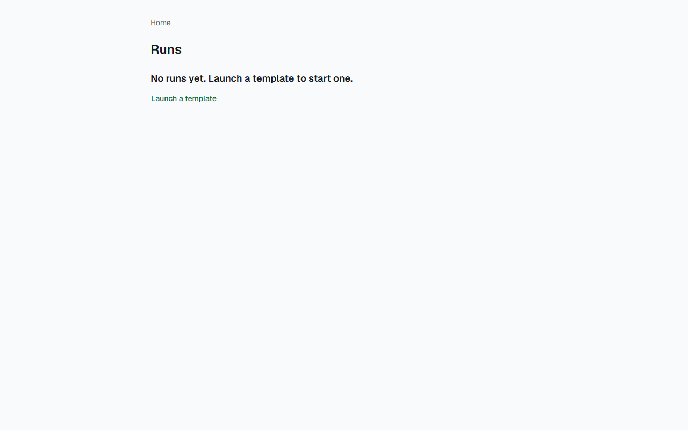

# Звіт UAT — 02.11.2026

- **Застосунок:** https://pmwp-ylehenkyi.vercel.app (/api/health: коміт `2ad9cf2`)
- **Код тестів:** `task/swap-ac-editor-07` @ `0908641`
- **Прогін:** 02.11.2026, 17:41 (Київ), Playwright 37.6 с; AC: 3 — PASS 3, FAIL 0, NEEDS-HUMAN 0
- **Рецензент:** `claude-haiku-5-5`; суперечки → `claude-sonnet-5-5`. Разом за розбір: $0.0066 (ціни API; за підпискою — у межах ліміту плану)
- **Прибирання:** синтетичних uat-*@example.test видалено 3, лишилось 0, їхніх рядків, що лишились: 0
- **Відео й траси:** не в git — `test-results/` локально або артефакт CI; трасу відкриває `npx playwright show-trace <trace.zip>`

| AC | Перевірки | Агент | Підсумок | Чому | Playwright | Розбір |
|---|---|---|---|---|---|---|
| AC-DSYS-02 | пройшли | Haiku: PASS | **PASS** | R6: перевірки, агент і цитати збігаються | 18.9 с | $0.0023, 10.0 с |
| AC-DSYS-04 | пройшли | Haiku: PASS | **PASS** | R6: перевірки, агент і цитати збігаються | 6.2 с | $0.0021, 7.9 с |
| AC-EDITOR-07 | пройшли | Haiku: PASS | **PASS** | R6: перевірки, агент і цитати збігаються | 6.4 с | $0.0021, 8.2 с |

## AC-DSYS-02 — PASS

**Тест:** AC-DSYS-02: manager B opens the editor of the template by a direct link and sees «Not enough rights» and «Back to templates»

**Критерій** (requirements/19-use-one-design-system.md):

> AC-DSYS-02: Given manager B signed in and the template "Tenant move-in" with current version 1. When B opens the editor of this template by a direct link. Then B sees the message "Not enough rights" and the link "Back to templates" in the same page layout as the other pages, no content of the editor, and the template stays at version 1 with no unpublished changes.

**Кроки:** ✔ Дано: manager B is signed in and the template «Tenant move-in» has a saved version → ✔ Коли: B opens the editor of this template by a direct link → ✔ Тоді: B sees the message "Not enough rights" and the link "Back to templates" in the same page layout as the other pages, no content of the editor, and the template stays at version 1 with no unpublished changes.

**Агент (claude-haiku-5-5, PASS):** На кадрі видно лише заголовок «Not enough rights» і посилання «Back to templates» на порожньому сірому фоні; кнопки «Save version» і полів редактора немає, тож текст сторінки складається тільки з цих двох написів. Частину «в тому самому макеті, що й інші сторінки» з одного кадру не перевірити, а в списку видимих частин її немає, тому вона не оцінювалася.

**Цитати агента, звірені зі сторінкою (aria):**
- «Not enough rights» — є на сторінці
- «Back to templates» — є на сторінці
- «Not enough rights» — є на сторінці
- «Back to templates» — є на сторінці

**Правило:** R6: перевірки, агент і цитати збігаються

**Відео:** `test-results/artifacts/access-and-states-AC-DSYS--7b70a-ts»-and-«Back-to-templates»-chromium/video.webm` · **траса:** `test-results/artifacts/access-and-states-AC-DSYS--7b70a-ts»-and-«Back-to-templates»-chromium/trace.zip` (не в git)

**Рішення PM:** ☐ приймаю · ☐ відхилення від вимог (issue «Відхилення від вимог: AC-DSYS-02 — …») · @login: ____

## AC-DSYS-04 — PASS

**Тест:** AC-DSYS-04: manager B who has no runs opens the list of runs and sees «No runs yet. Launch a template to start one.» and «Launch a template»

**Критерій** (requirements/19-use-one-design-system.md):

> AC-DSYS-04: Given manager B who has no runs. When B opens the list of runs. Then B sees the message "No runs yet. Launch a template to start one." and the link "Launch a template", and no empty table.

**Кроки:** ✔ Дано: manager B who has no runs → ✔ Коли: B opens the list of runs → ✔ Тоді: B sees the message "No runs yet. Launch a template to start one." and the link "Launch a template", and no empty table.

**Агент (claude-haiku-5-5, PASS):** На кадрі сторінки /runs з заголовком «Runs» видно точний текст «No runs yet. Launch a template to start one.» і посилання «Launch a template» кольором посилання. Таблиці на кадрі немає, але це частина «Не з кадрів», тому не оцінюю її.

**Цитати агента, звірені зі сторінкою (aria):**
- «No runs yet. Launch a template to start one.» — є на сторінці
- «Launch a template» — є на сторінці

**Правило:** R6: перевірки, агент і цитати збігаються

**Відео:** `test-results/artifacts/access-and-states-AC-DSYS--206ce-e-»-and-«Launch-a-template»-chromium/video.webm` · **траса:** `test-results/artifacts/access-and-states-AC-DSYS--206ce-e-»-and-«Launch-a-template»-chromium/trace.zip` (не в git)

**Рішення PM:** ☐ приймаю · ☐ відхилення від вимог (issue «Відхилення від вимог: AC-DSYS-04 — …») · @login: ____

## AC-EDITOR-07 — PASS

**Тест:** AC-EDITOR-07: manager B opens the list of versions of the template by a direct link and sees «Not enough rights» and no versions

**Критерій** (requirements/20-edit-a-template-with-version-control.md):

> AC-EDITOR-07: Given manager B signed in and the template "Tenant move-in" with versions 1 and 2. When B opens the list of versions of this template by a direct link. Then B sees the message "Not enough rights" and no versions.

**Кроки:** ✔ Дано: manager B signed in and the template «Tenant move-in» with saved versions (1 in the database) → ✔ Коли: B opens the list of versions of this template by a direct link → ✔ Тоді: B sees the message "Not enough rights" and no versions.

**Агент (claude-haiku-5-5, PASS):** На кадрі видно заголовок «Not enough rights» (великими й малими літерами збігається з критерієм) і посилання «Back to templates». Таблиці, рядків «Version N» або будь-якого списку версій немає, фон порожній. Частина про дані з бази не з кадрів, тому не оцінювалась.

**Цитати агента, звірені зі сторінкою (aria):**
- «Not enough rights» — є на сторінці
- «Not enough rights» — є на сторінці
- «Back to templates» — є на сторінці

**Правило:** R6: перевірки, агент і цитати збігаються

**Відео:** `test-results/artifacts/access-and-states-AC-EDITO-92a17-ugh-rights»-and-no-versions-chromium/video.webm` · **траса:** `test-results/artifacts/access-and-states-AC-EDITO-92a17-ugh-rights»-and-no-versions-chromium/trace.zip` (не в git)

**Рішення PM:** ☐ приймаю · ☐ відхилення від вимог (issue «Відхилення від вимог: AC-EDITOR-07 — …») · @login: ____

## Як читати підсумок

- **PASS** — автоматичні перевірки пройшли, агент-рецензент погодився з кадром, а кожну його цитату знайдено на сторінці.
- **FAIL** — впала автоматична перевірка. Агент цього не перекриває: невидимі вади (буфер обміну, база) він на кадрі не побачить.
- **NEEDS-HUMAN** — перевірки зелені, але агент не погодився або його цитати немає на сторінці. Часто це слабкий тест або розбіжність між текстом AC і тестом — питання до PM, а не обов'язково вада продукту.

Правила: R1: перевірка впала — FAIL завжди, агент не перекриває; R2: немає вердикту агента або кадру; R3: перевірки пройшли, агент не погоджується — вирішує людина; R4: цитати агента немає на сторінці (aria) — не підтверджено; R5: помилка сторінки або 5xx під час сценарію; R6: перевірки, агент і цитати збігаються.
