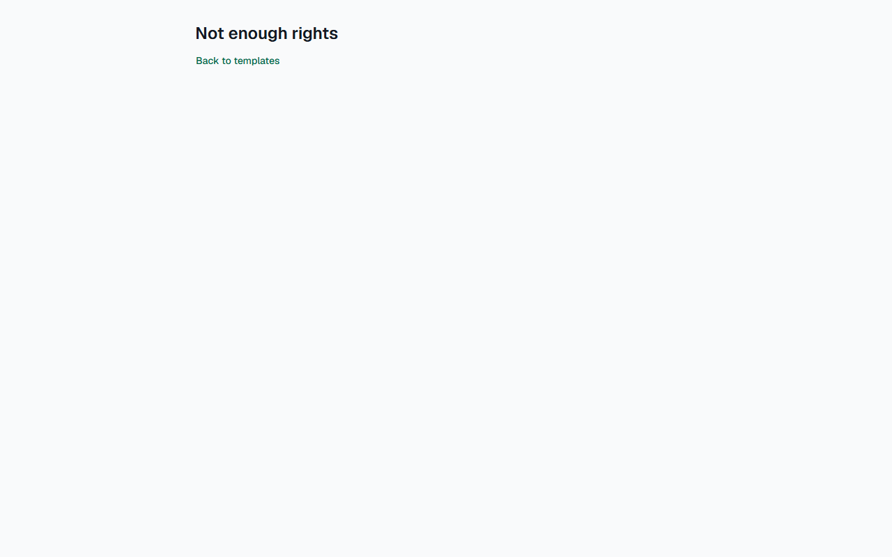
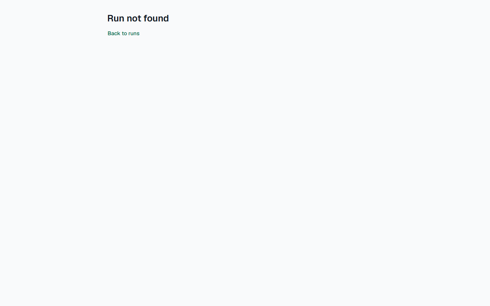

# Звіт UAT — 02.11.2026

- **Застосунок:** https://pmwp-ylehenkyi.vercel.app (/api/health: коміт `b5b8f91`)
- **Код тестів:** `task/uat` @ `d2bc783` + незакомічені зміни
- **Прогін:** 02.11.2026, 15:42 (Київ), Playwright 54.1 с; AC: 3 — PASS 3, FAIL 0, NEEDS-HUMAN 0
- **Рецензент:** `claude-haiku-5-5`; суперечки → `claude-sonnet-5-5`. Разом за розбір: $0.0054 (ціни API; за підпискою — у межах ліміту плану)
- **Прибирання:** синтетичних uat-*@example.test видалено 4, лишилось 0, їхніх рядків, що лишились: 0
- **Відео й траси:** не в git — `test-results/` локально або артефакт CI; трасу відкриває `npx playwright show-trace <trace.zip>`

| AC | Перевірки | Агент | Підсумок | Чому | Playwright | Розбір |
|---|---|---|---|---|---|---|
| AC-DSYS-02 | пройшли | Haiku: PASS | **PASS** | R6: перевірки, агент і цитати збігаються | 20.6 с | $0.0020, 13.5 с |
| AC-DSYS-04 | пройшли | Haiku: PASS | **PASS** | R6: перевірки, агент і цитати збігаються | 8.8 с | $0.0017, 9.7 с |
| AC-TASK-10 | пройшли | Haiku: PASS | **PASS** | R6: перевірки, агент і цитати збігаються | 12.2 с | $0.0018, 10.4 с |

## AC-DSYS-02 — PASS

**Тест:** AC-DSYS-02: manager B opens the editor of the template by a direct link and sees «Not enough rights» and «Back to templates»

**Критерій** (requirements/19-use-one-design-system.md):

> AC-DSYS-02: Given manager B signed in and the template "Tenant move-in" with current version 1. When B opens the editor of this template by a direct link. Then B sees the message "Not enough rights" and the link "Back to templates" in the same page layout as the other pages, no content of the editor, and the template stays at version 1 with no unpublished changes.

**Кроки:** ✔ Дано: manager B is signed in and the template «Tenant move-in» has a saved version → ✔ Коли: B opens the editor of this template by a direct link → ✔ Тоді: B sees the message "Not enough rights" and the link "Back to templates" in the same page layout as the other pages, no content of the editor, and the template stays at version 1 with no unpublished changes.

**Агент (claude-haiku-5-5, PASS):** На кадрі видно лише заголовок «Not enough rights» і посилання «Back to templates» на порожньому фоні; кнопки «Save version» і полів назв секцій чи завдань немає. Частина «no editor» перевірена відсутністю елементів, тому в quoted_text наведено весь текст, що є на кадрі. Твердження про «ту саму розмітку, що й інші сторінки» і про версію шаблону з кадру не видно, тож я їх не оцінював.

**Цитати агента, звірені зі сторінкою (aria):**
- «Not enough rights» — є на сторінці
- «Back to templates» — є на сторінці
- «Not enough rights» — є на сторінці
- «Back to templates» — є на сторінці

**Правило:** R6: перевірки, агент і цитати збігаються

**Відео:** `test-results/artifacts/access-and-states-AC-DSYS--7b70a-ts»-and-«Back-to-templates»-chromium/video.webm` · **траса:** `test-results/artifacts/access-and-states-AC-DSYS--7b70a-ts»-and-«Back-to-templates»-chromium/trace.zip` (не в git)

**Рішення PM:** ☐ приймаю · ☐ відхилення від вимог (issue «Відхилення від вимог: AC-DSYS-02 — …») · @login: ____

## AC-DSYS-04 — PASS

**Тест:** AC-DSYS-04: manager B who has no runs opens the list of runs and sees «No runs yet. Launch a template to start one.» and «Launch a template»

**Критерій** (requirements/19-use-one-design-system.md):

> AC-DSYS-04: Given manager B who has no runs. When B opens the list of runs. Then B sees the message "No runs yet. Launch a template to start one." and the link "Launch a template", and no empty table.

**Кроки:** ✔ Дано: manager B who has no runs → ✔ Коли: B opens the list of runs → ✔ Тоді: B sees the message "No runs yet. Launch a template to start one." and the link "Launch a template", and no empty table.

**Агент (claude-haiku-5-5, PASS):** На кадрі /runs видно заголовок «Runs», під ним повідомлення «No runs yet. Launch a template to start one.» і текстове посилання «Launch a template» у зеленувато-синьому кольорі. Текст збігається з критерієм посимвольно, таблиці на сторінці немає (це не оцінювалось за правилами).

**Цитати агента, звірені зі сторінкою (aria):**
- «No runs yet. Launch a template to start one.» — є на сторінці
- «Launch a template» — є на сторінці

**Правило:** R6: перевірки, агент і цитати збігаються

**Відео:** `test-results/artifacts/access-and-states-AC-DSYS--206ce-e-»-and-«Launch-a-template»-chromium/video.webm` · **траса:** `test-results/artifacts/access-and-states-AC-DSYS--206ce-e-»-and-«Launch-a-template»-chromium/trace.zip` (не в git)

**Рішення PM:** ☐ приймаю · ☐ відхилення від вимог (issue «Відхилення від вимог: AC-DSYS-04 — …») · @login: ____

## AC-TASK-10 — PASS

**Тест:** AC-TASK-10: manager C opens the page of a run that is not theirs by a direct link and sees «Run not found» and none of the tasks

**Критерій** (requirements/3-complete-tasks-and-track-run-progress.md):

> AC-TASK-10: Given a run of manager A and manager C, who is neither the run manager of this run nor an assignee in it. When manager C opens the page of this run by a direct link. Then manager C sees the message "Run not found" and none of the tasks of the run.

**Кроки:** ✔ Дано: a run of manager A, and manager C, who is neither its run manager nor an assignee in it → ✔ Коли: manager C opens the page of this run by a direct link → ✔ Тоді: manager C sees the message "Run not found" and none of the tasks of the run.

**Агент (claude-haiku-5-5, PASS):** На кадрі frame-then-1.png видно великий заголовок «Run not found» і посилання «Back to runs», жодних задач на сторінці немає. Текст читається чітко і збігається з критерієм посимвольно. Частину про відсутність задач перевіряють автоматичні перевірки, тому я її не оцінював.

**Цитати агента, звірені зі сторінкою (aria):**
- «Run not found» — є на сторінці

**Правило:** R6: перевірки, агент і цитати збігаються

**Відео:** `test-results/artifacts/access-and-states-AC-TASK--395ce-ound»-and-none-of-the-tasks-chromium/video.webm` · **траса:** `test-results/artifacts/access-and-states-AC-TASK--395ce-ound»-and-none-of-the-tasks-chromium/trace.zip` (не в git)

**Рішення PM:** ☐ приймаю · ☐ відхилення від вимог (issue «Відхилення від вимог: AC-TASK-10 — …») · @login: ____

## Як читати підсумок

- **PASS** — автоматичні перевірки пройшли, агент-рецензент погодився з кадром, а кожну його цитату знайдено на сторінці.
- **FAIL** — впала автоматична перевірка. Агент цього не перекриває: невидимі вади (буфер обміну, база) він на кадрі не побачить.
- **NEEDS-HUMAN** — перевірки зелені, але агент не погодився або його цитати немає на сторінці. Часто це слабкий тест або розбіжність між текстом AC і тестом — питання до PM, а не обов'язково вада продукту.

Правила: R1: перевірка впала — FAIL завжди, агент не перекриває; R2: немає вердикту агента або кадру; R3: перевірки пройшли, агент не погоджується — вирішує людина; R4: цитати агента немає на сторінці (aria) — не підтверджено; R5: помилка сторінки або 5xx під час сценарію; R6: перевірки, агент і цитати збігаються.
