# Звіт UAT — 06.11.2026

- **Застосунок:** https://pmwp-ylehenkyi.vercel.app (/api/health: коміт `41788a7`)
- **Код тестів:** `task/uat-vendor-evidence` @ `e7ef911` + незакомічені зміни
- **Прогін:** 06.11.2026, 12:10 (Київ), Playwright 245.6 с; AC: 13 — PASS 13, FAIL 0, NEEDS-HUMAN 0
- **Рецензент:** `claude-haiku-5-5`; суперечки → `claude-sonnet-5-5`. Разом за розбір: $0.1511 (ціни API; за підпискою — у межах ліміту плану)
- **Прибирання:** синтетичних uat-*@example.test видалено 23, лишилось 0, їхніх рядків, що лишились: 0
- **Відео й траси:** не в git — `test-results/` локально або артефакт CI; трасу відкриває `npx playwright show-trace <trace.zip>`

| AC | Перевірки | Агент | Підсумок | Чому | Playwright | Розбір |
|---|---|---|---|---|---|---|
| AC-DSYS-02 | пройшли | Haiku: PASS | **PASS** | R6: перевірки, агент і цитати збігаються | 21.2 с | $0.0021, 13.7 с |
| AC-DSYS-04 | пройшли | Haiku: PASS | **PASS** | R6: перевірки, агент і цитати збігаються | 8.7 с | $0.0017, 11.0 с |
| AC-EDITOR-07 | пройшли | Haiku: PASS | **PASS** | R6: перевірки, агент і цитати збігаються | 8.9 с | $0.0019, 11.7 с |
| AC-VENDOR-01 | пройшли | Haiku: NEEDS-HUMAN, Sonnet: PASS | **PASS** | R6: перевірки, агент і цитати збігаються | 27.5 с | $0.0327, 24.8 с |
| AC-VENDOR-02 | пройшли | Haiku: NEEDS-HUMAN, Sonnet: PASS | **PASS** | R6: перевірки, агент і цитати збігаються | 22.2 с | $0.0331, 29.7 с |
| AC-VENDOR-03 | пройшли | Haiku: PASS | **PASS** | R6: перевірки, агент і цитати збігаються | 14.3 с | $0.0023, 12.9 с |
| AC-VENDOR-04 | пройшли | Haiku: NEEDS-HUMAN, Sonnet: PASS | **PASS** | R6: перевірки, агент і цитати збігаються | 16.9 с | $0.0360, 28.8 с |
| AC-VENDOR-05 | пройшли | Haiku: PASS | **PASS** | R6: перевірки, агент і цитати збігаються | 19.9 с | $0.0018, 9.2 с |
| AC-VENDOR-06 | пройшли | Haiku: PASS | **PASS** | R6: перевірки, агент і цитати збігаються | 13.9 с | $0.0018, 8.7 с |
| AC-VENDOR-07 | пройшли | Haiku: NEEDS-HUMAN, Sonnet: PASS | **PASS** | R6: перевірки, агент і цитати збігаються | 17.4 с | $0.0323, 21.9 с |
| AC-VENDOR-08 | пройшли | Haiku: PASS | **PASS** | R6: перевірки, агент і цитати збігаються | 8.5 с | $0.0018, 9.3 с |
| AC-VENDOR-09 | пройшли | Haiku: PASS | **PASS** | R6: перевірки, агент і цитати збігаються | 17.0 с | $0.0021, 10.6 с |
| AC-VENDOR-10 | пройшли | Haiku: PASS | **PASS** | R6: перевірки, агент і цитати збігаються | 12.6 с | $0.0016, 7.8 с |

## AC-DSYS-02 — PASS

**Тест:** AC-DSYS-02: manager B opens the editor of the template by a direct link and sees «Not enough rights» and «Back to templates»

**Критерій** (requirements/19-use-one-design-system.md):

> AC-DSYS-02: Given manager B signed in and the template "Tenant move-in" with current version 1. When B opens the editor of this template by a direct link. Then B sees the message "Not enough rights" and the link "Back to templates" in the same page layout as the other pages, no content of the editor, and the template stays at version 1 with no unpublished changes.

**Кроки:** ✔ Дано: manager B is signed in and the template «Tenant move-in» has a saved version → ✔ Коли: B opens the editor of this template by a direct link → ✔ Тоді: B sees the message "Not enough rights" and the link "Back to templates" in the same page layout as the other pages, no content of the editor, and the template stays at version 1 with no unpublished changes.

**Агент (claude-haiku-5-5, PASS):** На кадрі видно лише заголовок «Not enough rights» і посилання «Back to templates» на порожньому світлому фоні; кнопки «Save version» і полів редактора немає. Окремої шапки чи навігації на кадрі немає, тож порівняти «той самий макет, що й інші сторінки» з одного кадру не можна, але цей пункт у переліку видимих частин не значиться. Версію шаблону та прапорець незбережених змін перевіряють з бази, тому їх не оцінював.

**Цитати агента, звірені зі сторінкою (aria):**
- «Not enough rights» — є на сторінці
- «Back to templates» — є на сторінці
- «Not enough rights» — є на сторінці
- «Back to templates» — є на сторінці

**Правило:** R6: перевірки, агент і цитати збігаються

**Відео:** `test-results/artifacts/access-and-states-AC-DSYS--7b70a-ts»-and-«Back-to-templates»-chromium/video.webm` · **траса:** `test-results/artifacts/access-and-states-AC-DSYS--7b70a-ts»-and-«Back-to-templates»-chromium/trace.zip` (не в git)

**Рішення PM:** ☐ приймаю · ☐ відхилення від вимог (issue «Відхилення від вимог: AC-DSYS-02 — …») · @login: ____

## AC-DSYS-04 — PASS

**Тест:** AC-DSYS-04: manager B who has no runs opens the list of runs and sees «No runs yet. Launch a template to start one.» and «Launch a template»

**Критерій** (requirements/19-use-one-design-system.md):

> AC-DSYS-04: Given manager B who has no runs. When B opens the list of runs. Then B sees the message "No runs yet. Launch a template to start one." and the link "Launch a template", and no empty table.

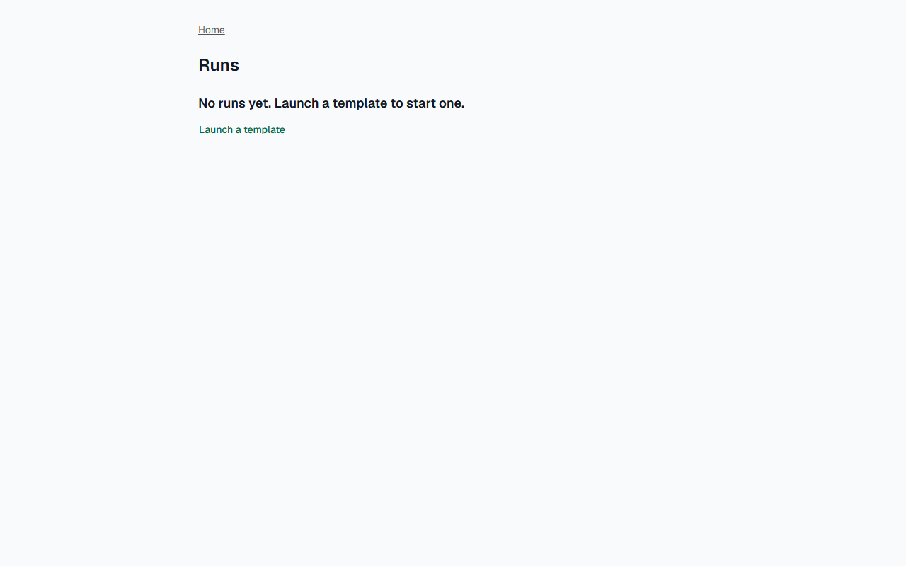

**Кроки:** ✔ Дано: manager B who has no runs → ✔ Коли: B opens the list of runs → ✔ Тоді: B sees the message "No runs yet. Launch a template to start one." and the link "Launch a template", and no empty table.

**Агент (claude-haiku-5-5, PASS):** На кадрі сторінки «Runs» видно повідомлення «No runs yet. Launch a template to start one.» і посилання «Launch a template» (кольором посилання, без підкреслення). Таблиці на кадрі немає, хоча це не з кадрів і не оцінюється.

**Цитати агента, звірені зі сторінкою (aria):**
- «No runs yet. Launch a template to start one.» — є на сторінці
- «Launch a template» — є на сторінці

**Правило:** R6: перевірки, агент і цитати збігаються

**Відео:** `test-results/artifacts/access-and-states-AC-DSYS--206ce-e-»-and-«Launch-a-template»-chromium/video.webm` · **траса:** `test-results/artifacts/access-and-states-AC-DSYS--206ce-e-»-and-«Launch-a-template»-chromium/trace.zip` (не в git)

**Рішення PM:** ☐ приймаю · ☐ відхилення від вимог (issue «Відхилення від вимог: AC-DSYS-04 — …») · @login: ____

## AC-EDITOR-07 — PASS

**Тест:** AC-EDITOR-07: manager B opens the list of versions of the template by a direct link and sees «Not enough rights» and no versions

**Критерій** (requirements/20-edit-a-template-with-version-control.md):

> AC-EDITOR-07: Given manager B signed in and the template "Tenant move-in" with versions 1 and 2. When B opens the list of versions of this template by a direct link. Then B sees the message "Not enough rights" and no versions.

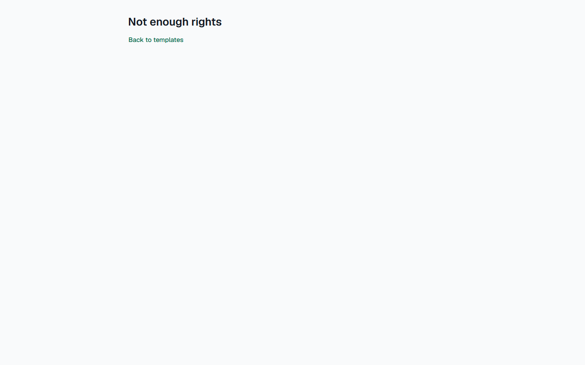

**Кроки:** ✔ Дано: manager B signed in and the template «Tenant move-in» with saved versions (1 in the database) → ✔ Коли: B opens the list of versions of this template by a direct link → ✔ Тоді: B sees the message "Not enough rights" and no versions.

**Агент (claude-haiku-5-5, PASS):** На кадрі frame-then-1.png видно заголовок «Not enough rights» і посилання «Back to templates». Таблиці, рядків «Version N» і списку версій на сторінці немає. Для другої частини цитата — весь видимий текст екрана, бо це відсутність елементів, а не написаний текст.

**Цитати агента, звірені зі сторінкою (aria):**
- «Not enough rights» — є на сторінці
- «Not enough rights» — є на сторінці
- «Back to templates» — є на сторінці

**Правило:** R6: перевірки, агент і цитати збігаються

**Відео:** `test-results/artifacts/access-and-states-AC-EDITO-92a17-ugh-rights»-and-no-versions-chromium/video.webm` · **траса:** `test-results/artifacts/access-and-states-AC-EDITO-92a17-ugh-rights»-and-no-versions-chromium/trace.zip` (не в git)

**Рішення PM:** ☐ приймаю · ☐ відхилення від вимог (issue «Відхилення від вимог: AC-EDITOR-07 — …») · @login: ____

## AC-VENDOR-01 — PASS

**Тест:** AC-VENDOR-01: manager A launches «Tenant move-in» for «Apartment 12, move-in» and assigns vendor V to tasks 3 and 4; tasks 3 and 4 have V and tasks 1, 2 and 5 have A

**Критерій** (requirements/39-assign-a-vendor-own-tasks.md):

> AC-VENDOR-01: Given manager A, vendor V and the template "Tenant move-in" with 5 tasks. When A launches the template for the case "Apartment 12, move-in" and assigns V as the assignee of tasks 3 and 4. Then tasks 3 and 4 have V as the assignee, and tasks 1, 2 and 5 have A.

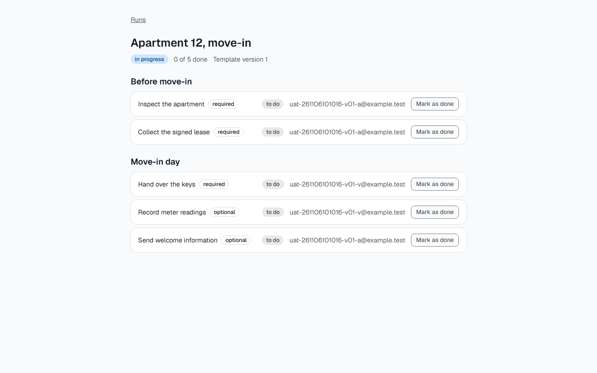

**Кроки:** ✔ Дано: manager A, vendor V and the template "Tenant move-in" with 5 tasks → ✔ Коли: A launches the template for the case "Apartment 12, move-in" and assigns V as the assignee of tasks 3 and 4 → ✔ Тоді: Tasks 3 and 4 have V as the assignee, and tasks 1, 2 and 5 have A.

**Агент (claude-sonnet-5-5, PASS):** На сторінці запуску «Apartment 12, move-in» задачі 3 і 4 («Hand over the keys», «Record meter readings») показують email з суфіксом -v@, а задачі 1, 2 і 5 — email з суфіксом -a@. Суфікси v/a відповідають vendor V і manager A, але самі облікові записи на кадрі не підписані.

Haiku сказав NEEDS-HUMAN, тож розбір повторив Sonnet; рішення агента — за Sonnet.

**Цитати агента, звірені зі сторінкою (aria):**
- «Hand over the keys» — є на сторінці
- «uat-261106101016-v01-v@example.test» — є на сторінці
- «Record meter readings» — є на сторінці
- «uat-261106101016-v01-v@example.test» — є на сторінці
- «Inspect the apartment» — є на сторінці
- «uat-261106101016-v01-a@example.test» — є на сторінці
- «Collect the signed lease» — є на сторінці
- «uat-261106101016-v01-a@example.test» — є на сторінці
- «Send welcome information» — є на сторінці
- «uat-261106101016-v01-a@example.test» — є на сторінці

**Правило:** R6: перевірки, агент і цитати збігаються

**Відео:** `test-results/artifacts/vendor-access-AC-VENDOR-01-b13b1--and-tasks-1-2-and-5-have-A-chromium/video.webm` · **траса:** `test-results/artifacts/vendor-access-AC-VENDOR-01-b13b1--and-tasks-1-2-and-5-have-A-chromium/trace.zip` (не в git)

**Рішення PM:** ☐ приймаю · ☐ відхилення від вимог (issue «Відхилення від вимог: AC-VENDOR-01 — …») · @login: ____

## AC-VENDOR-02 — PASS

**Тест:** AC-VENDOR-02: manager A opens the assignee picker and sees the emails of manager B, of the administrator and of vendor V, and no names, roles or other profile data

**Критерій** (requirements/39-assign-a-vendor-own-tasks.md):

> AC-VENDOR-02: Given managers A and B, an administrator and vendor V, and A launching a template. When A opens the assignee picker. Then A sees the emails of B, of the administrator and of V, and no names, roles or other profile data.

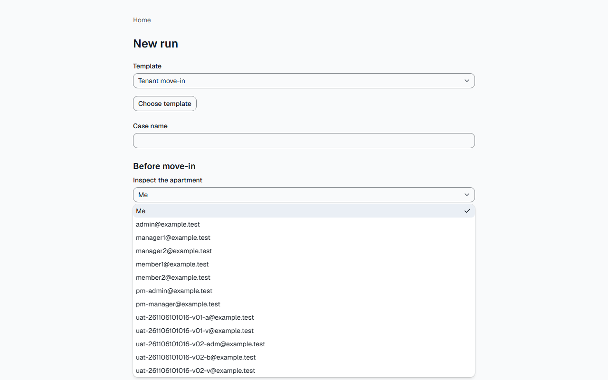

**Кроки:** ✔ Дано: managers A and B, an administrator and vendor V, and A launching a template → ✔ Коли: A opens the assignee picker → ✔ Тоді: A sees the emails of B, of the administrator and of V, and no names, roles or other profile data.

**Агент (claude-sonnet-5-5, PASS):** На кадрі відкритий випадаючий список виконавця: «Me» і далі лише email-адреси, включно з v02-b, v02-adm і v02-v. Поруч з жодним записом немає імені чи ролі.

Haiku сказав NEEDS-HUMAN, тож розбір повторив Sonnet; рішення агента — за Sonnet.

**Цитати агента, звірені зі сторінкою (aria):**
- «uat-261106101016-v02-b@example.test» — є на сторінці
- «uat-261106101016-v02-adm@example.test» — є на сторінці
- «uat-261106101016-v02-v@example.test» — є на сторінці
- «admin@example.test» — є на сторінці
- «manager1@example.test» — є на сторінці
- «manager2@example.test» — є на сторінці
- «member1@example.test» — є на сторінці
- «member2@example.test» — є на сторінці
- «pm-admin@example.test» — є на сторінці
- «pm-manager@example.test» — є на сторінці
- «uat-261106101016-v01-a@example.test» — є на сторінці
- «uat-261106101016-v01-v@example.test» — є на сторінці

**Правило:** R6: перевірки, агент і цитати збігаються

**Відео:** `test-results/artifacts/vendor-access-AC-VENDOR-02-bc3e1-roles-or-other-profile-data-chromium/video.webm` · **траса:** `test-results/artifacts/vendor-access-AC-VENDOR-02-bc3e1-roles-or-other-profile-data-chromium/trace.zip` (не в git)

**Рішення PM:** ☐ приймаю · ☐ відхилення від вимог (issue «Відхилення від вимог: AC-VENDOR-02 — …») · @login: ____

## AC-VENDOR-03 — PASS

**Тест:** AC-VENDOR-03: vendor V opens the list of runs and sees only the run "Apartment 12, move-in" with its run status and "Your tasks: 0 of 2 done", and does not see "Apartment 14, repair"

**Критерій** (requirements/39-assign-a-vendor-own-tasks.md):

> AC-VENDOR-03: Given vendor V who is the assignee of 2 tasks in the run "Apartment 12, move-in" and of no task in the run "Apartment 14, repair". When V opens the list of runs. Then V sees only the run "Apartment 12, move-in" with its run status and "Your tasks: 0 of 2 done", and does not see "Apartment 14, repair".

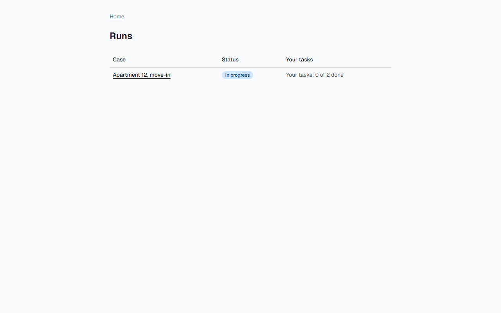

**Кроки:** ✔ Дано: vendor V who is the assignee of 2 tasks in the run "Apartment 12, move-in" and of no task in the run "Apartment 14, repair" → ✔ Коли: V opens the list of runs → ✔ Тоді: V sees only the run "Apartment 12, move-in" with its run status and "Your tasks: 0 of 2 done", and does not see "Apartment 14, repair".

**Агент (claude-haiku-5-5, PASS):** На кадрі сторінки /runs видно один рядок таблиці «Apartment 12, move-in» зі статусом «in progress» і написом «Your tasks: 0 of 2 done». Жодного рядка або тексту «Apartment 14, repair» на сторінці немає. Відсутність «Apartment 14, repair» видима на всьому кадрі, тому цитати для цієї частини немає (quoted_text порожній за самою природою відсутнього тексту).

**Цитати агента, звірені зі сторінкою (aria):**
- «Apartment 12, move-in» — є на сторінці
- «in progress» — є на сторінці
- «Your tasks: 0 of 2 done» — є на сторінці

**Правило:** R6: перевірки, агент і цитати збігаються

**Відео:** `test-results/artifacts/vendor-access-AC-VENDOR-03-17229-ot-see-Apartment-14-repair--chromium/video.webm` · **траса:** `test-results/artifacts/vendor-access-AC-VENDOR-03-17229-ot-see-Apartment-14-repair--chromium/trace.zip` (не в git)

**Рішення PM:** ☐ приймаю · ☐ відхилення від вимог (issue «Відхилення від вимог: AC-VENDOR-03 — …») · @login: ____

## AC-VENDOR-04 — PASS

**Тест:** AC-VENDOR-04: vendor V opens the run «Apartment 12, move-in» and sees exactly tasks 3 and 4, each with its name, its section, the mark «required» or «optional» and its status, and not tasks 1, 2 and 5, the emails of other users or the progress of the whole run

**Критерій** (requirements/39-assign-a-vendor-own-tasks.md):

> AC-VENDOR-04: Given vendor V who is the assignee of tasks 3 and 4 in the run "Apartment 12, move-in" (5 tasks). When V opens this run. Then V sees exactly tasks 3 and 4, each with its name, its section, the mark "required" or "optional" and its status, and does not see tasks 1, 2 and 5, the emails of other users or the progress of the whole run.

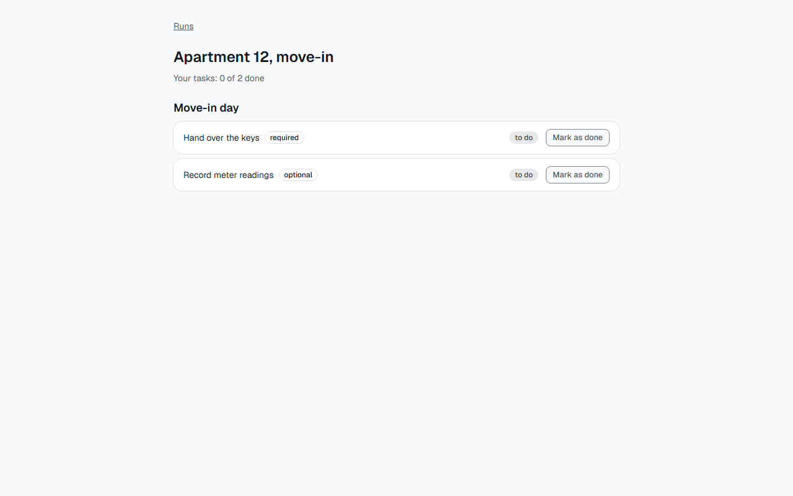

**Кроки:** ✔ Дано: vendor V who is the assignee of tasks 3 and 4 in the run "Apartment 12, move-in" (5 tasks) → ✔ Коли: V opens this run → ✔ Тоді: V sees exactly tasks 3 and 4, each with its name, its section, the mark "required" or "optional" and its status, and does not see tasks 1, 2 and 5, the emails of other users or the progress of the whole run.

**Агент (claude-sonnet-5-5, PASS):** На кадрі сторінка «Apartment 12, move-in» з єдиним заголовком секції «Move-in day» і двома завданнями: «Hand over the keys» (required, to do) та «Record meter readings» (optional, to do). Email-адрес і прогресу всього запуску немає, лише «Your tasks: 0 of 2 done». Номери завдань на кадрі не показано, тож відповідність завдань 3 і 4 судилася за кількістю (два з п'яти).

Haiku сказав NEEDS-HUMAN, тож розбір повторив Sonnet; рішення агента — за Sonnet.

**Цитати агента, звірені зі сторінкою (aria):**
- «Move-in day» — є на сторінці
- «Hand over the keys» — є на сторінці
- «Record meter readings» — є на сторінці
- «Hand over the keys» — є на сторінці
- «required» — є на сторінці
- «to do» — є на сторінці
- «Record meter readings» — є на сторінці
- «optional» — є на сторінці
- «to do» — є на сторінці
- «Your tasks: 0 of 2 done» — є на сторінці
- «Your tasks: 0 of 2 done» — є на сторінці

**Правило:** R6: перевірки, агент і цитати збігаються

**Відео:** `test-results/artifacts/vendor-access-AC-VENDOR-04-fdec2-e-progress-of-the-whole-run-chromium/video.webm` · **траса:** `test-results/artifacts/vendor-access-AC-VENDOR-04-fdec2-e-progress-of-the-whole-run-chromium/trace.zip` (не в git)

**Рішення PM:** ☐ приймаю · ☐ відхилення від вимог (issue «Відхилення від вимог: AC-VENDOR-04 — …») · @login: ____

## AC-VENDOR-05 — PASS

**Тест:** AC-VENDOR-05: vendor V marks task 3 as done; task 3 has status "done" and V sees "Your tasks: 1 of 2 done"

**Критерій** (requirements/39-assign-a-vendor-own-tasks.md):

> AC-VENDOR-05: Given vendor V who is the assignee of task 3 with status "to do", which is not the last required task of the run "Apartment 12, move-in". When V marks task 3 as done. Then task 3 has status "done", and V sees "Your tasks: 1 of 2 done".

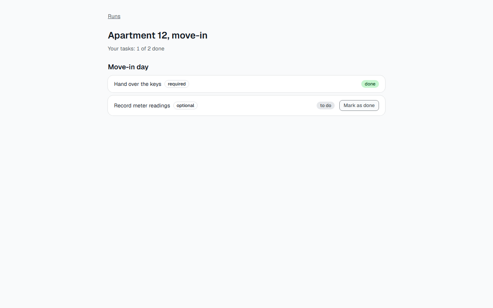

**Кроки:** ✔ Дано: vendor V who is the assignee of task 3 with status "to do", which is not the last required task of the run "Apartment 12, move-in" → ✔ Коли: V marks task 3 as done → ✔ Тоді: Task 3 has status "done", and V sees "Your tasks: 1 of 2 done".

**Агент (claude-haiku-5-5, PASS):** На кадрі видно картку «Hand over the keys» (позначка required) зі статусом «done» і текст «Your tasks: 1 of 2 done» під заголовком «Apartment 12, move-in». Кадр не показує номер завдання, тож відповідність «task 3» ґрунтується на назві, яку вказано в критерії.

**Цитати агента, звірені зі сторінкою (aria):**
- «Hand over the keys» — є на сторінці
- «done» — є на сторінці
- «Your tasks: 1 of 2 done» — є на сторінці

**Правило:** R6: перевірки, агент і цитати збігаються

**Відео:** `test-results/artifacts/vendor-access-AC-VENDOR-05-a75df-ees-Your-tasks-1-of-2-done--chromium/video.webm` · **траса:** `test-results/artifacts/vendor-access-AC-VENDOR-05-a75df-ees-Your-tasks-1-of-2-done--chromium/trace.zip` (не в git)

**Рішення PM:** ☐ приймаю · ☐ відхилення від вимог (issue «Відхилення від вимог: AC-VENDOR-05 — …») · @login: ____

## AC-VENDOR-06 — PASS

**Тест:** AC-VENDOR-06: vendor V opens by a direct link the page of the run "Apartment 14, repair" in which V has no task and sees "Run not found" and none of the tasks of the run

**Критерій** (requirements/39-assign-a-vendor-own-tasks.md):

> AC-VENDOR-06: Given the run "Apartment 14, repair" in which vendor V has no task. When V opens the page of this run by a direct link. Then V sees the message "Run not found" and none of the tasks of the run.

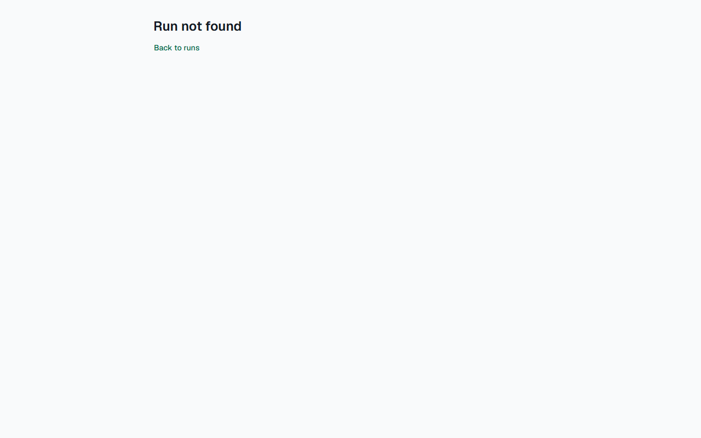

**Кроки:** ✔ Дано: the run "Apartment 14, repair" in which vendor V has no task → ✔ Коли: V opens the page of this run by a direct link → ✔ Тоді: V sees the message "Run not found" and none of the tasks of the run.

**Агент (claude-haiku-5-5, PASS):** На кадрі видно заголовок «Run not found» і посилання «Back to runs», більше нічого немає: завдань цього запуску на сторінці не показано. Кадр повний, не обрізаний і читабельний, тому вердикт PASS.

**Цитати агента, звірені зі сторінкою (aria):**
- «Run not found» — є на сторінці
- «Run not found» — є на сторінці
- «Back to runs» — є на сторінці

**Правило:** R6: перевірки, агент і цитати збігаються

**Відео:** `test-results/artifacts/vendor-access-AC-VENDOR-06-94e05-one-of-the-tasks-of-the-run-chromium/video.webm` · **траса:** `test-results/artifacts/vendor-access-AC-VENDOR-06-94e05-one-of-the-tasks-of-the-run-chromium/trace.zip` (не в git)

**Рішення PM:** ☐ приймаю · ☐ відхилення від вимог (issue «Відхилення від вимог: AC-VENDOR-06 — …») · @login: ____

## AC-VENDOR-07 — PASS

**Тест:** AC-VENDOR-07: vendor V tries to mark task 1 of manager A as done directly, bypassing the pages of the application; task 1 stays "to do"

**Критерій** (requirements/39-assign-a-vendor-own-tasks.md):

> AC-VENDOR-07: Given the run "Apartment 12, move-in" in which task 1 is assigned to manager A and tasks 3 and 4 to vendor V. When V tries to mark task 1 as done directly, bypassing the pages of the application. Then task 1 stays "to do".

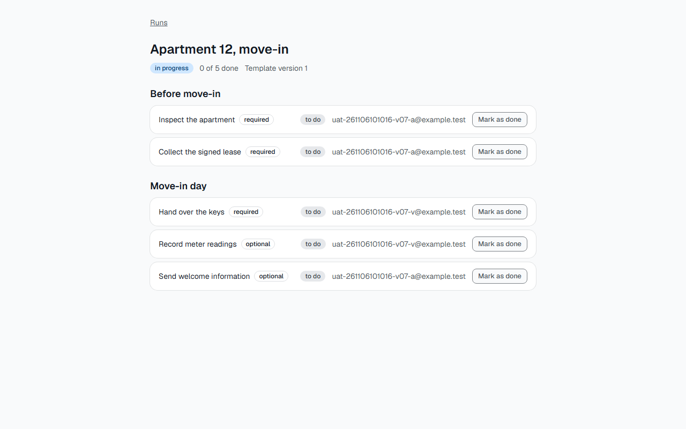

**Кроки:** ✔ Дано: the run "Apartment 12, move-in" in which task 1 is assigned to manager A and tasks 3 and 4 to vendor V → ✔ Коли: V tries to mark task 1 as done directly, bypassing the pages of the application → ✔ Тоді: Task 1 stays "to do".

**Агент (claude-sonnet-5-5, PASS):** На сторінці запуску «Apartment 12, move-in» перше завдання «Inspect the apartment» має статус «to do» і виконавця a@example.test. Завдання 3 і 4 призначені v@example.test, лічильник «0 of 5 done». Кадр прямо не показує, хто залогінений, але статус першого завдання видно чітко.

Haiku сказав NEEDS-HUMAN, тож розбір повторив Sonnet; рішення агента — за Sonnet.

**Цитати агента, звірені зі сторінкою (aria):**
- «Inspect the apartment» — є на сторінці
- «to do» — є на сторінці
- «uat-261106101016-v07-a@example.test» — є на сторінці

**Правило:** R6: перевірки, агент і цитати збігаються

**Відео:** `test-results/artifacts/vendor-access-AC-VENDOR-07-0edf6-ication-task-1-stays-to-do--chromium/video.webm` · **траса:** `test-results/artifacts/vendor-access-AC-VENDOR-07-0edf6-ication-task-1-stays-to-do--chromium/trace.zip` (не в git)

**Рішення PM:** ☐ приймаю · ☐ відхилення від вимог (issue «Відхилення від вимог: AC-VENDOR-07 — …») · @login: ____

## AC-VENDOR-08 — PASS

**Тест:** AC-VENDOR-08: vendor V signed in opens the list of templates by a direct link and sees "Not enough rights" and no template

**Критерій** (requirements/39-assign-a-vendor-own-tasks.md):

> AC-VENDOR-08: Given vendor V signed in. When V opens the list of templates by a direct link. Then V sees the message "Not enough rights" and no template.

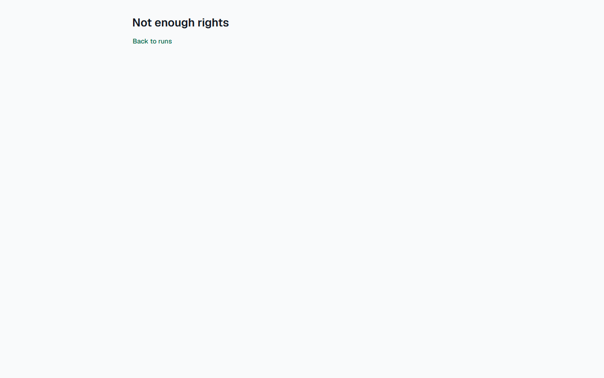

**Кроки:** ✔ Дано: vendor V signed in → ✔ Коли: V opens the list of templates by a direct link → ✔ Тоді: V sees the message "Not enough rights" and no template.

**Агент (claude-haiku-5-5, PASS):** На кадрі видно сторінку з заголовком «Not enough rights» і посиланням «Back to runs», більше тексту немає. Таблиці та назв шаблонів на кадрі немає, тому друга частина «Тоді» виконана. Для другої частини цитата — це весь видимий текст сторінки, бо саме відсутність шаблонів є ознакою.

**Цитати агента, звірені зі сторінкою (aria):**
- «Not enough rights» — є на сторінці
- «Not enough rights» — є на сторінці
- «Back to runs» — є на сторінці

**Правило:** R6: перевірки, агент і цитати збігаються

**Відео:** `test-results/artifacts/vendor-access-AC-VENDOR-08-dcf7b-ough-rights-and-no-template-chromium/video.webm` · **траса:** `test-results/artifacts/vendor-access-AC-VENDOR-08-dcf7b-ough-rights-and-no-template-chromium/trace.zip` (не в git)

**Рішення PM:** ☐ приймаю · ☐ відхилення від вимог (issue «Відхилення від вимог: AC-VENDOR-08 — …») · @login: ____

## AC-VENDOR-09 — PASS

**Тест:** AC-VENDOR-09: vendor V tries to launch the template "Tenant move-in" directly, bypassing the pages of the application; no run is created and the list of runs does not change

**Критерій** (requirements/39-assign-a-vendor-own-tasks.md):

> AC-VENDOR-09: Given vendor V signed in and the template "Tenant move-in" with current version 1. When V tries to launch this template directly, bypassing the pages of the application. Then no run is created, and the list of runs does not change.

**Кроки:** ✔ Дано: vendor V signed in and the template "Tenant move-in" with current version 1 → ✔ Коли: V tries to launch this template directly, bypassing the pages of the application → ✔ Тоді: No run is created, and the list of runs does not change.

**Агент (claude-haiku-5-5, PASS):** На кадрі frame-then-1.png (сторінка «Runs») видно єдиний рядок: «Apartment 12, move-in», статус «in progress», «Your tasks: 0 of 2 done». Рядка «Direct launch by vendor» або іншого нового запуску немає. Кадр один і повний, обрізання немає, тож вердикт PASS. Частини з розділу «Не з кадрів» не оцінювалися.

**Цитати агента, звірені зі сторінкою (aria):**
- «Apartment 12, move-in» — є на сторінці
- «Your tasks: 0 of 2 done» — є на сторінці
- «Apartment 12, move-in» — є на сторінці

**Правило:** R6: перевірки, агент і цитати збігаються

**Відео:** `test-results/artifacts/vendor-access-AC-VENDOR-09-191d2-ist-of-runs-does-not-change-chromium/video.webm` · **траса:** `test-results/artifacts/vendor-access-AC-VENDOR-09-191d2-ist-of-runs-does-not-change-chromium/trace.zip` (не в git)

**Рішення PM:** ☐ приймаю · ☐ відхилення від вимог (issue «Відхилення від вимог: AC-VENDOR-09 — …») · @login: ____

## AC-VENDOR-10 — PASS

**Тест:** AC-VENDOR-10: vendor V to whom no task is assigned opens the list of runs and sees "No tasks assigned to you yet." and no empty table

**Критерій** (requirements/39-assign-a-vendor-own-tasks.md):

> AC-VENDOR-10: Given vendor V to whom no task is assigned. When V opens the list of runs. Then V sees the message "No tasks assigned to you yet." and no empty table.

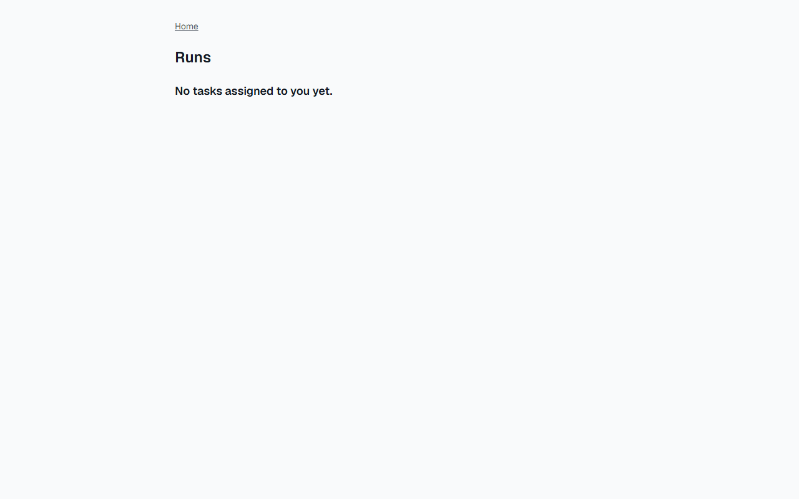

**Кроки:** ✔ Дано: vendor V to whom no task is assigned → ✔ Коли: V opens the list of runs → ✔ Тоді: V sees the message "No tasks assigned to you yet." and no empty table.

**Агент (claude-haiku-5-5, PASS):** На кадрі сторінки /runs (заголовок «Runs») видно текст «No tasks assigned to you yet.», посимвольно збігається з критерієм. Таблиці на сторінці немає, решта кадру порожня.

**Цитати агента, звірені зі сторінкою (aria):**
- «No tasks assigned to you yet.» — є на сторінці

**Правило:** R6: перевірки, агент і цитати збігаються

**Відео:** `test-results/artifacts/vendor-access-AC-VENDOR-10-c5ce7--you-yet-and-no-empty-table-chromium/video.webm` · **траса:** `test-results/artifacts/vendor-access-AC-VENDOR-10-c5ce7--you-yet-and-no-empty-table-chromium/trace.zip` (не в git)

**Рішення PM:** ☐ приймаю · ☐ відхилення від вимог (issue «Відхилення від вимог: AC-VENDOR-10 — …») · @login: ____

## Як читати підсумок

- **PASS** — автоматичні перевірки пройшли, агент-рецензент погодився з кадром, а кожну його цитату знайдено на сторінці.
- **FAIL** — впала автоматична перевірка. Агент цього не перекриває: невидимі вади (буфер обміну, база) він на кадрі не побачить.
- **NEEDS-HUMAN** — перевірки зелені, але агент не погодився або його цитати немає на сторінці. Часто це слабкий тест або розбіжність між текстом AC і тестом — питання до PM, а не обов'язково вада продукту.

Правила: R1: перевірка впала — FAIL завжди, агент не перекриває; R2: немає вердикту агента або кадру; R3: перевірки пройшли, агент не погоджується — вирішує людина; R4: цитати агента немає на сторінці (aria) — не підтверджено; R5: помилка сторінки або 5xx під час сценарію; R6: перевірки, агент і цитати збігаються.
