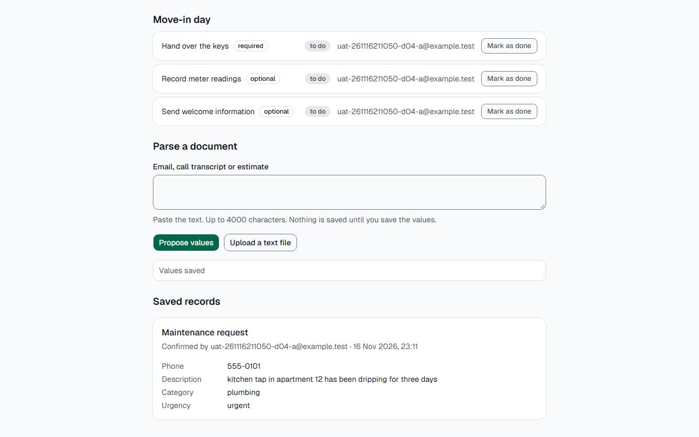
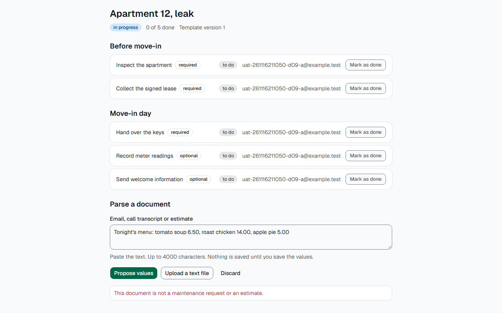
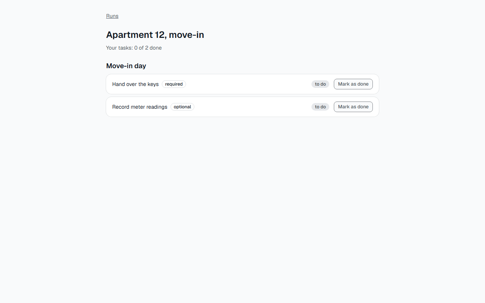
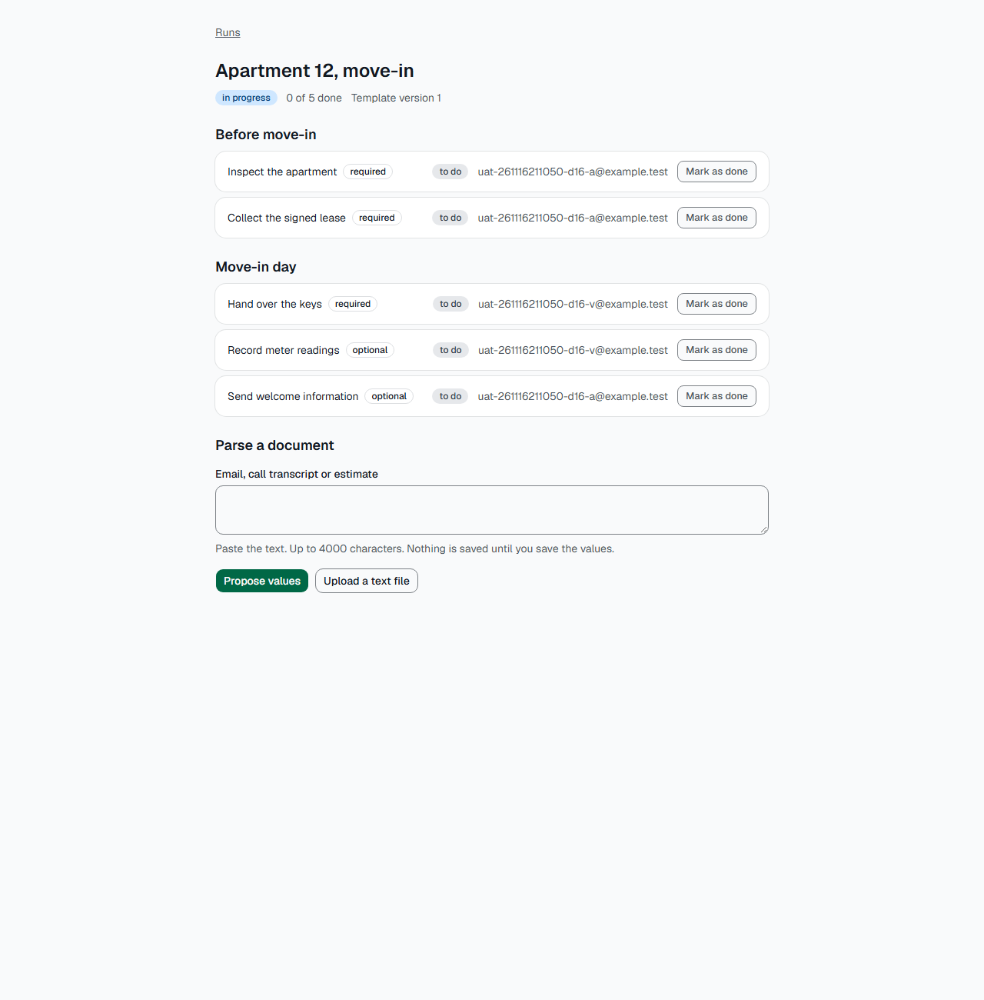

# Звіт UAT — 16.11.2026

- **Застосунок:** https://pmwp-ylehenkyi.vercel.app (/api/health: коміт `d91543f`)
- **Код тестів:** `task/uat-docai` @ `ce73e23`
- **Прогін:** 16.11.2026, 23:10 (Київ), Playwright 113.2 с; AC: 4 — PASS 4, FAIL 0, NEEDS-HUMAN 0
- **Рецензент:** `claude-haiku-5-5`; суперечки → `claude-sonnet-5-5`. Разом за розбір: $0.0885 (ціни API; за підпискою — у межах ліміту плану)
- **Прибирання:** синтетичних uat-*@example.test видалено 7, лишилось 0, їхніх рядків, що лишились: 0
- **Відео й траси:** не в git — `test-results/` локально або артефакт CI; трасу відкриває `npx playwright show-trace <trace.zip>`

| AC | Перевірки | Агент | Підсумок | Чому | Playwright | Розбір |
|---|---|---|---|---|---|---|
| AC-DOCAI-04 | пройшли | Haiku: PASS | **PASS** | R6: перевірки, агент і цитати збігаються | 35.8 с | $0.0055, 12.0 с |
| AC-DOCAI-09 | пройшли | Haiku: PASS | **PASS** | R6: перевірки, агент і цитати збігаються | 18.2 с | $0.0053, 10.5 с |
| AC-DOCAI-14 | пройшли | Haiku: NEEDS-HUMAN, Sonnet: PASS | **PASS** | R6: перевірки, агент і цитати збігаються | 10.0 с | $0.0729, 25.1 с |
| AC-DOCAI-16 | пройшли | Haiku: PASS | **PASS** | R6: перевірки, агент і цитати збігаються | 32.9 с | $0.0049, 15.5 с |

## AC-DOCAI-04 — PASS

**Тест:** AC-DOCAI-04: run manager A changes Urgency to "urgent" and saves; the page of the run shows one saved record with the type, the values, the email of A and the date and time

**Критерій** (requirements/59-parse-a-document-confirm-values.md):

> AC-DOCAI-04: Given run manager A with Document type "Maintenance request", Phone "555-0101", Category "plumbing" and Urgency "not urgent" proposed in the block. When A changes Urgency to "urgent" and chooses "Save values". Then the page of the run shows one saved record with Document type "Maintenance request", Phone "555-0101", Category "plumbing" and Urgency "urgent", the email of A and the date and time of the confirmation.

**Кроки:** ✔ Дано: run manager A with Document type "Maintenance request", Phone "555-0101", Category "plumbing" and Urgency "not urgent" proposed in the block → ✔ Коли: A changes Urgency to "urgent" and chooses "Save values" → ✔ Тоді: The page of the run shows one saved record with Document type "Maintenance request", Phone "555-0101", Category "plumbing" and Urgency "urgent", the email of A and the date and time of the confirmation.

**Агент (claude-haiku-5-5, PASS):** На кадрі видно розділ «Saved records» з одним записом «Maintenance request», у якому Phone 555-0101, Category plumbing і Urgency urgent, а також рядок «Confirmed by» з email uat-261116211050-d04-a@example.test і датою 16 Nov 2026, 23:11. Запис містить також Description, якого критерій не вимагає, — це не вада. Email відповідає адресі учасника A з рядків «Move-in day», але сама особа A на кадрі безпосередньо не позначена.

**Цитати агента, звірені зі сторінкою (aria):**
- «Saved records» — є на сторінці
- «Maintenance request» — є на сторінці
- «Phone» — є на сторінці
- «555-0101» — є на сторінці
- «Category» — є на сторінці
- «plumbing» — є на сторінці
- «Urgency» — є на сторінці
- «urgent» — є на сторінці
- «Confirmed by uat-261116211050-d04-a@example.test · 16 Nov 2026, 23:11» — є на сторінці

**Правило:** R6: перевірки, агент і цитати збігаються

**Відео:** `test-results/artifacts/document-parsing-AC-DOCAI--05e1a--of-A-and-the-date-and-time-chromium/video.webm` · **траса:** `test-results/artifacts/document-parsing-AC-DOCAI--05e1a--of-A-and-the-date-and-time-chromium/trace.zip` (не в git)

**Рішення PM:** ☐ приймаю · ☐ відхилення від вимог (issue «Відхилення від вимог: AC-DOCAI-04 — …») · @login: ____

## AC-DOCAI-09 — PASS

**Тест:** AC-DOCAI-09: run manager A pastes a restaurant menu; the block shows "This document is not a maintenance request or an estimate." and no value is proposed

**Критерій** (requirements/59-parse-a-document-confirm-values.md):

> AC-DOCAI-09: Given run manager A and the pasted text "Tonight's menu: tomato soup 6.50, roast chicken 14.00, apple pie 5.00". When A chooses "Propose values". Then the block shows "This document is not a maintenance request or an estimate." and no value is proposed.

**Кроки:** ✔ Дано: run manager A and the pasted text "Tonight's menu: tomato soup 6.50, roast chicken 14.00, apple pie 5.00" → ✔ Коли: A chooses "Propose values" → ✔ Тоді: The block shows "This document is not a maintenance request or an estimate." and no value is proposed.

**Агент (claude-haiku-5-5, PASS):** На кадрі під полем із текстом меню («Tonight's menu: tomato soup 6.50, roast chicken 14.00, apple pie 5.00») з'явилося червоне повідомлення «This document is not a maintenance request or an estimate.», текст збігається з критерієм посимвольно. У блоці «Parse a document» немає поля Document type, запропонованих значень і кнопки «Save values»; для цієї частини цитата порожня, бо перевірено відсутність елементів.

**Цитати агента, звірені зі сторінкою (aria):**
- «This document is not a maintenance request or an estimate.» — є на сторінці

**Правило:** R6: перевірки, агент і цитати збігаються

**Відео:** `test-results/artifacts/document-parsing-AC-DOCAI--7f1fa-te-and-no-value-is-proposed-chromium/video.webm` · **траса:** `test-results/artifacts/document-parsing-AC-DOCAI--7f1fa-te-and-no-value-is-proposed-chromium/trace.zip` (не в git)

**Рішення PM:** ☐ приймаю · ☐ відхилення від вимог (issue «Відхилення від вимог: AC-DOCAI-09 — …») · @login: ____

## AC-DOCAI-14 — PASS

**Тест:** AC-DOCAI-14: vendor V who is the assignee of tasks 3 and 4 opens the page of the run and does not see the block "Parse a document"

**Критерій** (requirements/59-parse-a-document-confirm-values.md):

> AC-DOCAI-14: Given vendor V who is the assignee of tasks 3 and 4 in the run "Apartment 12, move-in". When V opens the page of this run. Then V does not see the block "Parse a document".

**Кроки:** ✔ Дано: vendor V who is the assignee of tasks 3 and 4 in the run "Apartment 12, move-in" → ✔ Коли: V opens the page of this run → ✔ Тоді: V does not see the block "Parse a document".

**Агент (claude-sonnet-5-5, PASS):** На кадрі сторінка запуску «Apartment 12, move-in» з написом «Your tasks: 0 of 2 done» і двома задачами (Hand over the keys, Record meter readings). Блоків «Parse a document» чи «Propose values» на всій видимій сторінці немає.

Haiku сказав NEEDS-HUMAN, тож розбір повторив Sonnet; рішення агента — за Sonnet.

**Цитати агента, звірені зі сторінкою (aria):**
- «Apartment 12, move-in» — є на сторінці
- «Your tasks: 0 of 2 done» — є на сторінці
- «Hand over the keys» — є на сторінці
- «Record meter readings» — є на сторінці
- «Move-in day» — є на сторінці

**Правило:** R6: перевірки, агент і цитати збігаються

**Відео:** `test-results/artifacts/document-parsing-AC-DOCAI--f0ea4-the-block-Parse-a-document--chromium/video.webm` · **траса:** `test-results/artifacts/document-parsing-AC-DOCAI--f0ea4-the-block-Parse-a-document--chromium/trace.zip` (не в git)

**Рішення PM:** ☐ приймаю · ☐ відхилення від вимог (issue «Відхилення від вимог: AC-DOCAI-14 — …») · @login: ____

## AC-DOCAI-16 — PASS

**Тест:** AC-DOCAI-16: vendor V, or manager B who is not the run manager, tries to ask the AI for values or to save values for the run directly, bypassing the pages; they receive no value and no record is saved

**Критерій** (requirements/59-parse-a-document-confirm-values.md):

> AC-DOCAI-16: Given vendor V, or manager B who is not the run manager, in the run "Apartment 12, move-in". When they try to ask the AI for values or to save values for this run directly, bypassing the pages of the application. Then they receive no value, no record is saved, and they see the message "Not enough rights".

**Кроки:** ✔ Дано: vendor V, or manager B who is not the run manager, in the run "Apartment 12, move-in" → ✔ Коли: they try to ask the AI for values or to save values for this run directly, bypassing the pages of the application → ✔ Тоді: They receive no value, no record is saved, and they see the message "Not enough rights".

**Агент (claude-haiku-5-5, PASS):** На кадрі під блоком «Parse a document» є лише форма вставки тексту, підказка «Nothing is saved until you save the values.» і кнопки «Propose values» та «Upload a text file»; розділу «Saved records» і жодного запису немає. Кадр не показує, під яким користувачем зайдено, тож що це сторінка саме менеджера A, підтверджено лише адресою сторінки з ac.md, а не екраном.

**Цитати агента, звірені зі сторінкою (aria):**
- «Parse a document» — є на сторінці
- «Paste the text. Up to 4000 characters. Nothing is saved until you save the values.» — є на сторінці
- «Propose values» — є на сторінці
- «Upload a text file» — є на сторінці

**Правило:** R6: перевірки, агент і цитати збігаються

**Відео:** `test-results/artifacts/document-parsing-AC-DOCAI--2a7d3-alue-and-no-record-is-saved-chromium/video.webm` · **траса:** `test-results/artifacts/document-parsing-AC-DOCAI--2a7d3-alue-and-no-record-is-saved-chromium/trace.zip` (не в git)

**Рішення PM:** ☐ приймаю · ☐ відхилення від вимог (issue «Відхилення від вимог: AC-DOCAI-16 — …») · @login: ____

## Як читати підсумок

- **PASS** — автоматичні перевірки пройшли, агент-рецензент погодився з кадром, а кожну його цитату знайдено на сторінці.
- **FAIL** — впала автоматична перевірка. Агент цього не перекриває: невидимі вади (буфер обміну, база) він на кадрі не побачить.
- **NEEDS-HUMAN** — перевірки зелені, але агент не погодився або його цитати немає на сторінці. Часто це слабкий тест або розбіжність між текстом AC і тестом — питання до PM, а не обов'язково вада продукту.

Правила: R1: перевірка впала — FAIL завжди, агент не перекриває; R2: немає вердикту агента або кадру; R3: перевірки пройшли, агент не погоджується — вирішує людина; R4: цитати агента немає на сторінці (aria) — не підтверджено; R5: помилка сторінки або 5xx під час сценарію; R6: перевірки, агент і цитати збігаються.
